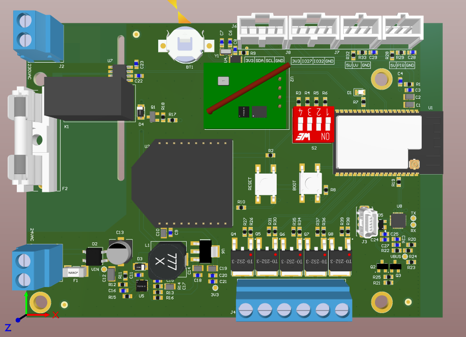
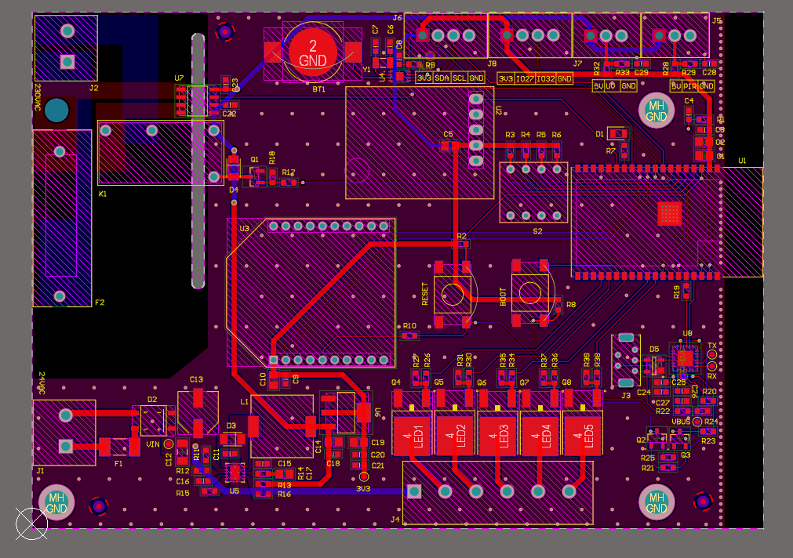

# ESP32 Mains Relay Switch PCB

A custom PCB that pairs an ESP32 microcontroller with a mains-rated relay, so AC
appliances can be switched over Wi-Fi or Bluetooth. Intended uses are home
automation, industrial I/O control and smart-energy projects that need safe,
remote switching of high-voltage loads.

| 3D view | 2D layout |
| --- | --- |
| [](images/pcb-3d-view.png) | [](images/pcb-layout-2d.png) |

## Repository layout

```
ESP32-Relay-Switch-var-1/
├── PCB/                                   # Altium Designer project
│   ├── ESP32-Realy-Switch-var-1.PrjPCB    # Project file (open this)
│   ├── ESP32-Realy-Switch-var-1.PcbDoc    # PCB layout
│   ├── ESP32-Realy-Switch-var-1.PCBDwf    # Draftsman drawing
│   ├── Power Supply.SchDoc                # Schematic sheets
│   ├── Relay.SchDoc
│   ├── RF.SchDoc
│   ├── USB-PROG.SchDoc
│   ├── CONNECTORS.SchDoc
│   ├── RF.Harness, CONNECTORS.Harness     # Signal harness definitions
│   └── OutJob.OutJob                      # Output job (fab / assembly outputs)
└── images/                                # Renders used in this README
```

## Component library

This repo stores no libraries. Every part comes from the general Altium library
in [Gueni/0000_libraries](https://github.com/Gueni/0000_libraries):

| File | Used for |
| --- | --- |
| [`Altium/DATABASE.DbLib`](https://github.com/Gueni/0000_libraries/blob/master/Altium/DATABASE.DbLib) | Database library the schematic components link to |
| [`Altium/DB.mdb`](https://github.com/Gueni/0000_libraries/blob/master/Altium/DB.mdb) | Parts database (part numbers, MPNs, suppliers) |
| [`Altium/SCH.SchLib`](https://github.com/Gueni/0000_libraries/blob/master/Altium/SCH.SchLib) | Schematic symbols |
| [`Altium/FTP.PcbLib`](https://github.com/Gueni/0000_libraries/blob/master/Altium/FTP.PcbLib) | PCB footprints and 3D models |

### Setup

The project finds the library through a relative path, so clone both repos side
by side in the same workspace folder:

```
WORKSPACE/
├── 0000_libraries/                   # git clone https://github.com/Gueni/0000_libraries.git
└── 0005_esp32_1/
    └── ESP32-Relay-Switch-var-1/     # this repo
```

The project file references `..\..\..\0000_libraries\Altium\DATABASE.DbLib` and
adds `..\..\..\0000_libraries\Altium\` as a library search path. The DbLib's
database path is absolute (`D:\WORKSPACE\0000_libraries\Altium\DB.mdb`); see the
[library README](https://github.com/Gueni/0000_libraries#setup) if your
workspace lives elsewhere.
